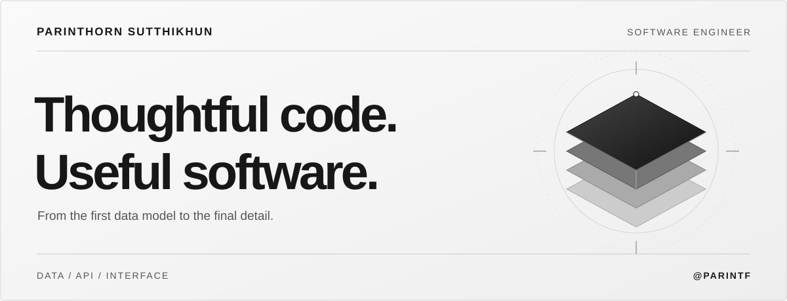
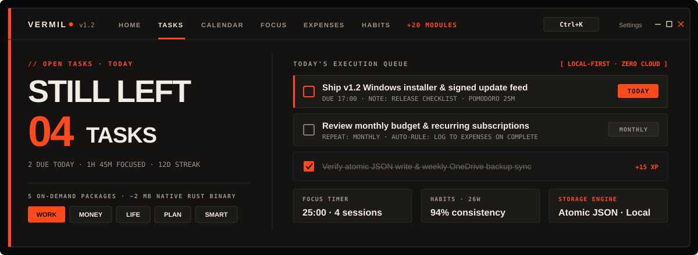

 

**Engineered from the ground up — clean data models, fast APIs, and sharp interfaces.**

  

[**Explore my portfolio ↗**](https://parinthorn-portfolio.parinwork00.chatgpt.site) &nbsp; · &nbsp; [GitHub projects](https://github.com/ParinTF?tab=repositories) &nbsp; · &nbsp; [Say hello](mailto:xibomivi@gmail.com)

 

## Less talk. More building.

A few projects connecting thoughtful systems with useful experiences.

### Vermil Tasks
**One light Windows app for everyday life. Only the tools you switch on.**

A modular, local-first desktop app for Windows that starts empty and loads only the modules you turn on. Built as a ~2 MB native app with no account, no cloud server, and everything stored safely on your computer.

- **26 on-demand modules** across 5 packages (*Work, Money, Life, Plan, Smart*) — tasks, notes, calendar, Pomodoro focus timer, expenses, habits, goals, automations, and an opt-in Gemini assistant
- **Keyboard-first workflow** with a `Ctrl+K` command palette, global Windows shortcuts (`Ctrl+Alt+T` / `N` / `W`), and an always-on-top Today widget
- **Local-first & crash-safe** single-JSON storage with automatic weekly backups and shared-folder sync across machines

**Rust · Tauri 2 · JavaScript · HTML/CSS · Windows**

[Source code ↗](https://github.com/ParinTF/vermil-tasks) · [Download for Windows ↗](https://github.com/ParinTF/vermil-tasks/releases/latest)

 

<table>
<tr>
<td width="50%" valign="top">

### Bonsai
**Big goals. Small, steady steps.**

A hierarchical goal tracker with draggable goal graphs, daily habits, weekly commitments, and progress that rolls up automatically.

**.NET · React · TypeScript · MongoDB**

[Source code ↗](https://github.com/ParinTF/Bonsai) · [Try the demo ↗](https://bonsai-dww.pages.dev)

</td>
<td width="50%" valign="top">

### Curio
**Your story. Your next chapter.**

A full-stack resume builder with a live preview, four templates, customizable colors and fonts, PDF export, and public sharing.

- Next.js interface with a real-time preview
- Go REST API for all data reads and writes
- PostgreSQL JSONB for flexible resume content
- Supabase Auth with JWT verification

**Next.js · Go · PostgreSQL · Supabase**

[Source code ↗](https://github.com/ParinTF/Curio) · [Try the demo ↗](https://curio-umber.vercel.app)

</td>
</tr>
</table>

 

---

### Good software. A human touch.

### Hi, I'm Parinthorn.
**Software Engineer · @ParinTF**

I'm a full-stack developer who enjoys taking a project from its **data model and API to the interface people use**.

I mostly work with **.NET, Go, Rust, and TypeScript**, backed by **MongoDB or PostgreSQL**. I'm interested in clean data models, backend architecture, and making useful products.

### My toolkit

---

### Let's talk about what we can build.

[Portfolio ↗](https://parinthorn-portfolio.parinwork00.chatgpt.site) &nbsp; · &nbsp; [Email](mailto:xibomivi@gmail.com) &nbsp; · &nbsp; [LinkedIn](https://www.linkedin.com/in/parinthorn-sutthikhun-a402541b4)

